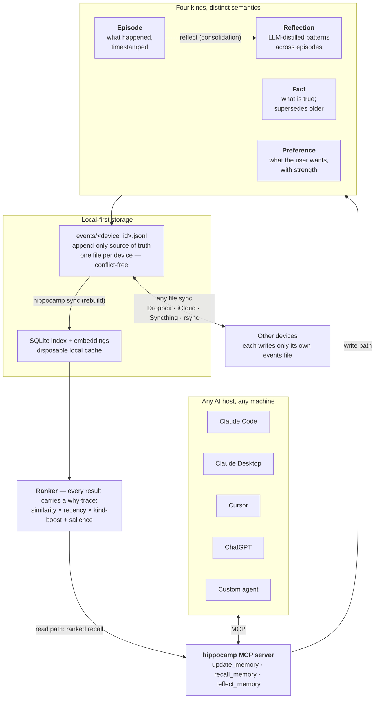

# Hippocamp

**Tiered memory for AI — episodes, facts, preferences, reflections. Local. Portable. Yours.**

Tell Claude something on your laptop, recall it from Cursor on your desktop. Mention a preference to ChatGPT, your custom agent will know it too. Your memory is yours, runs locally, syncs everywhere.

## Why this exists

Most AI memory is a flat bag of strings — every "thing remembered" treated the same, ranked against everything else by raw similarity. That collapses fast under real use: a passing chat from last Tuesday, a stable fact about your job, and "the user prefers terse replies" all compete on the same axis.

**Hippocamp models memory the way cognition does — distinct kinds, distinct semantics:**

- **Episodes** — what happened, timestamped.
- **Facts** — what is true (about the user, the project, the world).
- **Preferences** — what the user wants, with a strength.
- **Reflections** — higher-order patterns the system distils across many episodes via an LLM (consolidation, via `reflect`).

Each kind is ranked on its own terms. Relevance to the question decides; kind and age only break ties. Facts, preferences and reflections do not fade with age — they stay true until replaced — while episodes lose a little ground as they get older. Replace a fact (`supersedes`) and the old one stops coming back. Every result comes back with a **why-trace** (similarity, wording overlap, kind, age) and a `match` label: "strong" when it is about the question, "weak" when it is only the nearest thing stored.

And it's local. ChatGPT's memory works only in ChatGPT; Claude Code's only in Claude Code; cloud agent-memory services (Mem0, Zep, Letta) put your data on their servers. Hippocamp lives in a directory you control, and any AI that speaks MCP can read or write it — so the same tiered memory follows you across every host and every machine you own.

The supporting wedges:

- **First-class forgetting** — replace a memory, forget it, expire by age, or purge it so the text is erased from the log and the cache (`hippocamp forget --purge`, `expire`, `compact`).
- **Conflict-free sync** — each device writes to `events/<device_id>.jsonl`, so no two machines ever touch the same file. Every cloud-sync service handles this safely by definition.
- **Local-first** — the SQLite index lives on each machine; `events/` is the portable source of truth. Wipe the cache anytime; `hippocamp sync` rebuilds it.

## Architecture at a glance



---

## Get started in 30 seconds

```bash
pip install 'hippocamp[mcp,embeddings-lite]'
hippocamp setup claude
```

The `embeddings-lite` extra (~150 MB) uses [fastembed](https://github.com/qdrant/fastembed) — same BGE-small embedder, ONNX runtime instead of PyTorch. For higher recall on hard cases there's also `[embeddings]` (~900 MB, adds sentence-transformers + Qwen3 as an option).

Restart Claude Code. Try this — and watch the inline "*Saved to Hippocamp*" annotations as Claude proactively captures the signals:

> *"I'm building a Python 3.13 project with FastAPI. I prefer terse replies. By the way, hippocamps are half-horse, half-fish — and they're not hippopotamuses."*

Three saves happen automatically: a fact (Python 3.13 + FastAPI), a preference (terse replies), and a fact about hippocamps. No "remember" required.

Then in any future Claude session — even a fresh one tomorrow on a different machine — ask *"what do you know about my project?"* or *"what's a hippocamp again?"* and it'll come back with the right answer.

## Make it work on every machine you own

Pick a folder your cloud syncs (Dropbox, iCloud, Syncthing — anything). On every machine, run:

```bash
hippocamp setup claude --path ~/Dropbox/Hippocamp
```

That's literally it. Memory written on your laptop appears on your desktop, your work machine, anywhere. Nothing to configure, nothing to merge, nothing to think about.

## Use it with other AIs

```bash
hippocamp setup claude-desktop      # Claude Desktop
hippocamp setup cursor              # Cursor
hippocamp setup gemini-cli          # Gemini CLI
```

Same memory, every host. Pass the same `--path` if you want cross-machine sync.

## How Claude uses your memory

Once wired up, Claude uses Hippocamp **proactively** — not just when you say "remember":

- **Saves automatically** when you state a preference, a stable fact about your project or tooling, a decision, or a notable event. Each save is announced inline (*"Saved to Hippocamp: preference (terse replies)"*) so you always know what's been captured.
- **Recalls automatically** when you reference past context.
- **Skips noise** — hypotheticals, transient debugging state, code outputs, things already in this session.

If something gets saved that you don't want, just say *"forget that"* in conversation — Claude calls the forget action. Or run `hippocamp inspect` to see everything stored.

## Consolidation (reflect)

Raw episodes pile up fast. Periodically Hippocamp runs an LLM pass that reads recent episodes, distils out the durable user-modelling content (facts, preferences, higher-order reflections), and writes it back. Near-duplicate facts are *superseded*, not duplicated — so recall surfaces clean signal instead of noisy repetition.

Reflect works through every episode it has not read yet, oldest first, in small batches, and records which ones it has read — so nothing is skipped however old it is or however late it arrived from another device. The model is shown the stored memories closest to each batch; a new fact replaces an old one only when the model names it, never on resemblance alone.

Run it on demand, or on a cron:

```bash
hippocamp reflect                     # local model; everything not yet read
hippocamp reflect --since 2026-05-01  # re-read from a date (repeats are not stored twice)
```

Reflection reads your private memory, so by default it runs on a **local model** and nothing leaves the machine:

1. **Local (default)** — any OpenAI-compatible server on this machine (LM Studio, llama.cpp server, Ollama's `/v1`, `mlx_lm.server`). Defaults to `http://127.0.0.1:1234` and the first chat model it lists; override with `HIPPOCAMP_LLM_URL` and `HIPPOCAMP_LLM_MODEL`. A non-loopback URL is refused.
2. **Bring your own** — pass any object with a `complete(prompt, *, system) -> str` method via `Memory(llm=...)`.
3. **Cloud, only on purpose** — `hippocamp reflect --llm anthropic` (needs `pip install 'hippocamp[llm]'` and `ANTHROPIC_API_KEY`) or `--llm claude-cli`. Both send episode text to Anthropic and refuse to run unless `HIPPOCAMP_ALLOW_CLOUD_REFLECT=1` is set. Neither is ever chosen automatically.

The MCP server's `reflect_memory` tool uses the local model too, and fails with a clear error if the local server isn't running — it never falls back to a cloud model.

## Several stores, one server

One `hippocamp-mcp` process can hold several separate stores — one per
person in a household, plus a shared one — behind a single embedder, so
the model is loaded once however many stores there are.

Set `HIPPOCAMP_STORES` to a JSON object of store id → directory:

```bash
HIPPOCAMP_STORES='{"alice": "~/.hippocamp", "bob": "~/people/bob/memory", "home": "~/household/memory"}' hippocamp-mcp
```

In this mode every tool call names the store it acts on:

| Tool | Argument | Meaning |
|---|---|---|
| `recall_memory` | `stores` (required, list) | Stores to search. With more than one, results are merged by score and each carries the `store` it came from. |
| `update_memory` | `store` (required) | The one store to write to. Memory ids are per store. |
| `reflect_memory` | `store` (required) | The one store to reflect over. |

What this is and is not:

- **The id selects a store; it is not a filter.** Each store keeps its own
  directory, event log and cache. A query can only return what is in the
  stores it named.
- **Ids come from the fixed map.** An id outside it is refused, and the
  error does not list the valid ones, so an id can never become a path.
- **It is not access control between callers.** Any client of the server
  can name any id in the map. Use it behind a harness that fills the
  argument in itself and never lets a model choose it.
- **All stores must use the same embedder.** A store committed to a
  different one is refused when first opened; the others keep working.
- **Without `HIPPOCAMP_STORES` nothing changes:** one store at
  `HIPPOCAMP_PATH`, and the tools take no store argument.

Create a new empty store with `hippocamp init --path <dir>`. Reflect and
sync stay per store: `hippocamp reflect --path <dir>`. Never `hippocamp
sync` one person's store into another's — it copies whole event files.

## What just happened

Each AI you wired up now has three new tools — `recall_memory`, `update_memory`, and `reflect_memory` — that read and write a private SQLite database on your machine. Memory is *yours*: never sent to a third party, portable across every AI, lives on every device you own.

```
~/Dropbox/Hippocamp/         ← cloud-synced (the data — meta + per-device events)
~/Library/Caches/hippocamp/  ← local-only (the index, rebuilt automatically)
```

That's the whole architecture. Each device writes only to its own events file (no sync conflicts ever); the local cache is rebuilt on demand.

---

## Day-to-day commands

```bash
hippocamp inspect                     # see what's stored, with why-traces
hippocamp inspect --query "python"    # ranked recall

hippocamp status                      # what's stored, where, by which devices

hippocamp sync                        # rebuild local cache from events
hippocamp sync <local-path>           # merge events from a file/dir, then rebuild
hippocamp sync <user@host[:path]>     # bidirectional rsync, then rebuild

hippocamp instructions                # print the directive (full)
hippocamp instructions --short        # compact version (paste into Claude Desktop / ChatGPT custom instructions)

hippocamp reindex [--embedder NAME]   # recompute embeddings (after a model swap)

hippocamp forget <id>                 # stop returning a memory (text stays in the log)
hippocamp forget <id> --purge         # ...and erase its text from the log and cache
hippocamp expire --before 90d --kind episode   # forget by age (TTL)
hippocamp compact                     # erase the text of everything already forgotten

hippocamp reflect                     # consolidate recent episodes (requires LLM)
hippocamp reflect --since <iso-ts>    # explicit cutoff instead of meta.last_reflect_at
```

`hippocamp sync` is one smart command — give it a local path (USB stick, downloaded folder, anything), an SSH peer (`user@desktop.local`), or no argument at all (just rebuild the cache from whatever Dropbox/iCloud/Syncthing has dropped into your events directory). Memory ends up consistent either way.

## Python library

```python
import hippocamp as hc

mem = hc.Memory(path="~/Dropbox/Hippocamp")

mem.observe("User asked whether hippocamps swim in lakes (no — saltwater only)")
mem.assert_fact("A hippocamp is half-horse, half-fish, and also a Python package")
mem.assert_preference("Strongly objects to being called a 'hippopotamus'", strength=1.0)

hits = mem.recall("am I a horse, a fish, or a hippopotamus?", limit=5)
for h in hits:
    print(h.kind, h.text, h.score, h.why.note)
```

## Make Claude prefer Hippocamp over its built-in memory

Done automatically. `hippocamp setup claude` writes a Hippocamp directive into `~/.claude/CLAUDE.md` so the assistant prefers Hippocamp over Claude Code's built-in auto-memory. The block is wrapped in `<!-- hippocamp:start -->` / `<!-- hippocamp:end -->` markers — re-running setup is idempotent, and any unrelated content in your `CLAUDE.md` is preserved.

Opt out if you want to manage instructions yourself:

```bash
hippocamp setup claude --no-instructions
```

Or also write the directive into a project-scoped `CLAUDE.md`:

```bash
hippocamp setup claude --project-instructions ~/projects/myapp
# → also writes ~/projects/myapp/CLAUDE.md with the same block
```

## Quality checks

`pytest` runs the behaviour tests (`tests/test_fitness.py` pins every fix in [docs/fitness-plan.md](docs/fitness-plan.md)). `python evals/recall_bench.py` measures recall on a made-up household against the minimums in `evals/thresholds.json`, and `python evals/reflect_live.py` checks consolidation with your local model. All of it runs on synthetic data in throwaway stores; none of it opens a real store.

Known limit: similarity scores cannot reliably tell "same topic" from "answers the question", so `match: "weak"` only catches the clearest cases of "nothing stored about this".

## Status

**v0.12 (alpha, unreleased).** Architecture stable. Ambient memory is live on Claude Code (the directive auto-installs into `~/.claude/CLAUDE.md`); Claude Desktop requires a one-time paste from `hippocamp instructions --short` into Settings → Profile. One `hippocamp setup claude` command configures Claude Code and Claude Desktop together when both are installed. LLM-driven consolidation (`reflect`) ships in this release. Cross-machine sync works through any file-sync tool you already use (iCloud, Dropbox, Syncthing, rsync, git). **Roadmap to v1.0:** encryption at rest, event-log compaction / snapshotting, HTTP/SSE transport for self-hosted always-on stores.

## License

Apache-2.0
